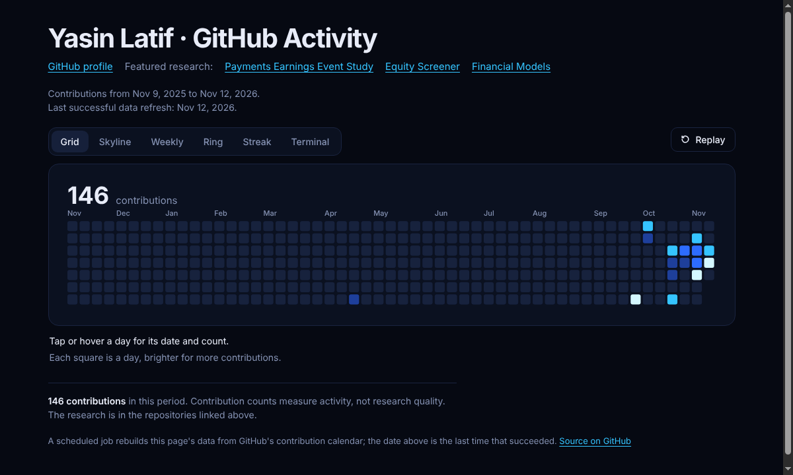

# GitHub Activity Graph

### [View the live graph](https://yasinlatif22-cpu.github.io/contrib-gragh/)

An animated view of my GitHub contribution calendar for the past year, drawn six ways (grid, skyline, weekly, ring, streak and
terminal) and published with GitHub Pages. It refreshes daily.

[](https://yasinlatif22-cpu.github.io/contrib-gragh/)

*The grid view, captured on Nov 12, 2026. Contribution counts measure activity, not research quality; the research is in the
repositories linked from the page.*

## How it works
- `scripts/fetch-github.mjs` reads the contribution calendar and writes `data/github.js`. It asks the GitHub GraphQL API first
  and falls back to the public contribution calendar on the profile page if the API returns nothing or zero.
- `.github/workflows/update-graph.yml` runs it every day at 09:17 UTC and commits the file if it changed.
- `index.html` reads `data/github.js` and draws the graph. The page shows the date of the last successful refresh.
- If neither source returns data, the script exits with an error and leaves the last good data in place, so a failed refresh
  shows up in the Actions tab instead of publishing an empty graph.

## Run it yourself
```bash
GH_USER=<your-username> node scripts/fetch-github.mjs   # uses GITHUB_TOKEN or `gh auth token` if available
```
The profile-page fallback shows public contributions only. To give the workflow a personal token for the API path, add it as the
repository secret `CONTRIB_TOKEN`.
